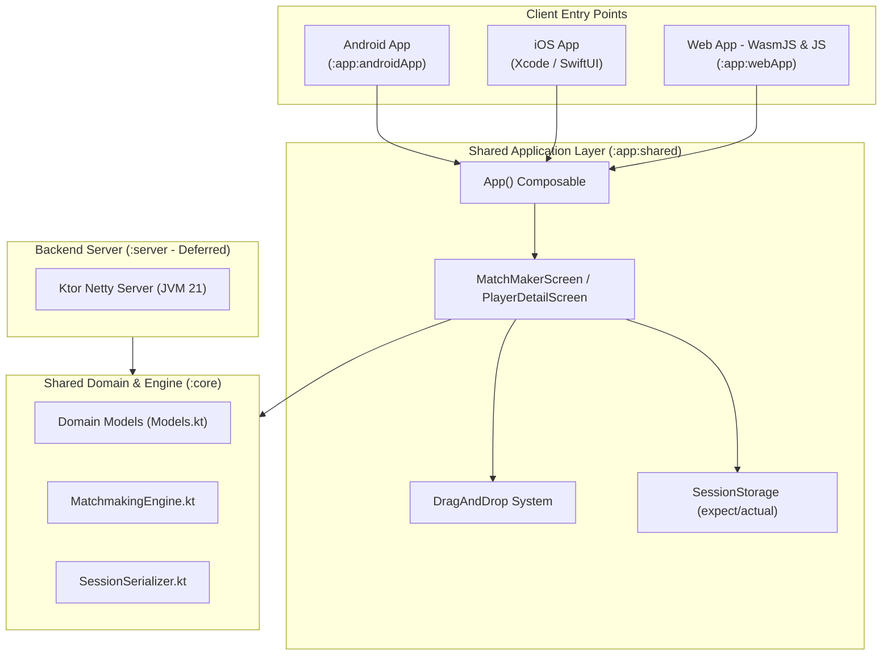
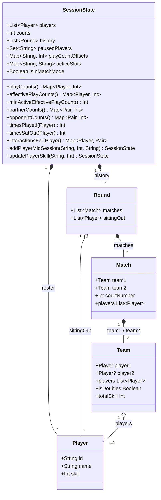
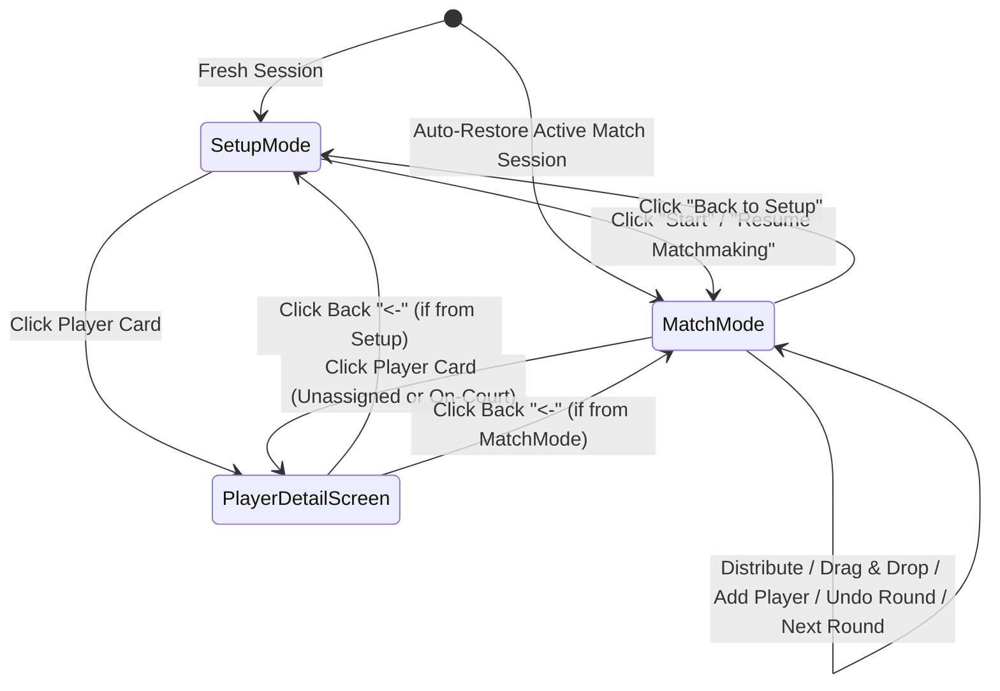

# MatchMaker — Product & Architecture Document

## 1. Product Overview

**MatchMaker** is a local-first, cross-platform court and player scheduling application built with **Kotlin Multiplatform (KMP)** and **Compose Multiplatform**. It is designed for recreational and club sports sessions (such as badminton, pickleball, tennis, or padel) where a variable number of players of varying skill levels rotate across a fixed number of courts over multiple rounds.

### Core Value Proposition
Organizing fair round-robin or open-play sessions manually becomes difficult when player counts do not divide evenly into available courts, when skill levels vary, or when players arrive late / take breaks. MatchMaker solves this by:
1. **Maximizing Play Time Fairness**: Ensuring no player sits out disproportionately more than others, including late arrivals who join mid-session.
2. **Preventing Stacked Matches**: Using player skill ratings (`1–5`) to balance combined team skill levels on each court (avoiding `5+5` vs `1+1` blowouts) while still allowing small skill differences so everyone gets to play with everyone.
3. **Maximizing Social Variety**: Weighting repeat partnerships and repeat opponent matchups equally (`10L` each in separate buckets) so players rotate through all teammates and opponents.
4. **Interactive Control & Session Recovery**: Combining one-click algorithmic court assignment with drag-and-drop manual adjustments, inline mid-session player additions, **Undo Last Round** slot restoration, and automatic cross-platform persistence.
5. **Real-Time Analytics**: Tracking individual play/sit-out counts, skill ratings, and partner/opponent interaction distributions.

---

## 2. System Architecture

MatchMaker is structured as a multi-module Gradle project leveraging Kotlin Multiplatform (`2.4.0`) and Compose Multiplatform (`1.11.1`) across Android, iOS, Web (WasmJS & JS), and a JVM Ktor backend.

### Module Breakdown

| Module | Path | Targets | Responsibility |
| :--- | :--- | :--- | :--- |
| **`:core`** | `core/build.gradle.kts` | Android, iOS, JVM (`21`), JS, WasmJS | Houses all core domain models (`Models.kt`), the optimization engine (`MatchmakingEngine.kt`), lossless state serialization (`SessionSerializer.kt`), and the core invariant test suite (`MatchmakingTest.kt`). |
| **`:app:shared`** | `app/shared/build.gradle.kts` | `androidLibrary`, `iosArm64`, `iosSimulatorArm64`, `js`, `wasmJs` | Houses the shared Compose Multiplatform UI (`App.kt`, `MatchMakerScreen.kt`), custom drag-and-drop system (`DragAndDrop.kt`), and platform-specific local persistence (`SessionStorage.kt`). |
| **`:app:androidApp`** | `app/androidApp/build.gradle.kts` | Android (`minSdk 24`, `compileSdk 36`) | Android application wrapper hosting `MainActivity`, initializing `SessionStorage` with `SharedPreferences` and rendering Compose edge-to-edge. |
| **`:app:iosApp`** | `app/iosApp/iosApp/ContentView.swift` | iOS (`arm64`, Simulator `arm64`) | SwiftUI host app embedding the static `Shared` framework via `MainViewController` (`ComposeUIViewController`). |
| **`:app:webApp`** | `app/webApp/build.gradle.kts` | `wasmJs`, `js` (Browser) | Browser executable mounting `App()` into the DOM via `ComposeViewport`. |
| **`:server`** | `server/build.gradle.kts` | JVM (`Toolchain 21`) | Ktor `3.5.0` Netty server (`Application.kt`) with direct access to `:core` for future multi-device session sync. |

---

## 3. Domain Model & Data Structures

All core domain entities reside in `core/src/commonMain/kotlin/org/grant/matchmaker/domain/Models.kt` as immutable Kotlin data classes, supporting unidirectional state flow and full persistence.

### Key Domain Capabilities
* **Player Skill Ratings (`1–5`)**: `Player` enforces a skill rating in `1..5` (defaulting to `1`), and `Team.totalSkill` computes the combined skill of a team (`player1.skill + (player2?.skill ?: 0)`).
* **Late-Arrival Virtual Play-Count Offsets**: When a player joins mid-session via `addPlayerMidSession`, their `playCountOffsets[player.id]` is seeded with `minActiveEffectivePlayCount()`. `MatchmakingEngine` uses `effectivePlayCounts()` (`actual + offset`) so late arrivals enter the normal rotation immediately without hogging courts, while `timesPlayed(player)` still reports their true actual games played.
* **Normalized ID-Based Pair Tracking**: `SessionState` normalizes player pairs by `Player.id` (`partnerCountsById`, `opponentCountsById`) so updating a player's skill rating mid-session preserves all historical partner and opponent counts seamlessly.
* **Lossless Persistence**: `SessionSerializer` encodes and decodes the entire `SessionState` (including `activeSlots`, `isInMatchMode`, `playCountOffsets`, `pausedPlayers`, and `history`), backed by `SessionStorage` (`SharedPreferences` on Android, `NSUserDefaults` on iOS, `localStorage` on Web WasmJS/JS).

---

## 4. Matchmaking Engine & Optimization Algorithm

The scheduling engine in `core/src/commonMain/kotlin/org/grant/matchmaker/domain/MatchmakingEngine.kt` uses a **Multi-Start Stochastic Hill-Climbing** algorithm to generate optimal court assignments for each round.

### Court Allocation Policy
Given $N$ active (unpaused) players and $C$ available courts:
1. **Doubles Priority**: Courts are first filled with 4-player doubles matches while $\text{remainingPlayers} \ge 4$ and $\text{court} \le C$.
2. **Singles Fallback**: Remaining open courts are filled with 2-player singles matches while $\text{remainingPlayers} \ge 2$ and $\text{court} \le C$.
3. **Sit-Outs**: Any remaining active players, along with all `pausedPlayers`, are placed in the round's `sittingOut` list.

### Cost / Penalty Objective Function
Each candidate permutation of active players is evaluated by `calculateScore`. Lower scores represent better, fairer schedules. The total penalty $S$ across all scheduled courts in the candidate round is:

$$S = \sum_{p \in P_{\text{playing}}} W_{\text{play}} \cdot c_{\text{eff}}(p)^2 + \sum_{m \in M} W_{\text{skill}} \cdot \Delta_{\text{team}}(m)^2 + \sum_{(p_i, p_j) \in E_{\text{partner}}} W_{\text{partner}} \cdot c_{\text{partner}}(p_i, p_j)^2 + \sum_{(p_i, p_j) \in E_{\text{opponent}}} W_{\text{opponent}} \cdot c_{\text{opponent}}(p_i, p_j)^2$$

Where:
* $c_{\text{eff}}(p) = c_{\text{play}}(p) + \text{offset}(p)$ is the effective play count of player $p$.
* $\Delta_{\text{team}}(m) = |\text{skill}(\text{team}_1) - \text{skill}(\text{team}_2)|$ is the team skill difference on court $m$ (`(s1 + s2) - (s3 + s4)` for doubles, `s1 - s2` for singles).
* $c_{\text{partner}}(p_i, p_j)$ is the historical count of times $p_i$ and $p_j$ have partnered.
* $c_{\text{opponent}}(p_i, p_j)$ is the historical count of times $p_i$ and $p_j$ have faced each other as opponents.
* **Weights**:
  * `PLAY_COUNT_WEIGHT` ($W_{\text{play}} = 1,000,000$): Strictly prioritizes players who have played fewer effective games so everyone gets equal court time.
  * `SKILL_WEIGHT` ($W_{\text{skill}} = 15$): Penalizes team skill mismatches quadratically. Extreme stacked matchups (e.g., `5+5` vs `1+1`, where $\Delta_{\text{team}} = 8$ and penalty $= 8^2 \times 15 = 960$) are heavily rejected in favor of balanced pairings (`5+1` vs `5+1`, penalty $= 0$), while small skill differences ($\Delta_{\text{team}} = 1 \text{ or } 2$, penalty $= 15 \text{ to } 60$) remain low enough that players still rotate across all partners and opponents over time.
  * `PARTNER_WEIGHT` ($W_{\text{partner}} = 10$) & `OPPONENT_WEIGHT` ($W_{\text{opponent}} = 10$): Tracked in separate buckets with equal weight (`10L` each), penalizing repeat partners and repeat opponents equally while still allowing players who opposed each other in one round to partner up in the next.

---

## 5. Features & User Flows

The UI is implemented in `app/shared/src/commonMain/kotlin/org/grant/matchmaker/ui/MatchMakerScreen.kt` and transitions cleanly between three primary views:

### 5.1 Session Setup Mode
* **Court Configuration**: Define the number of available courts via numeric input.
* **Roster & Skill Entry**: Add players by name along with a `1–5` skill rating selector (`FilterChip` row, defaulting to `1`).
* **Reset Session Dialog**: Clicking **Reset Session** prompts with two choices:
  * **Keep Roster**: Clears match history, active slots, paused states, and offsets while preserving the player list and court count.
  * **Clear Everything**: Wipes the entire session and clears persisted local storage.

### 5.2 Matchmaking & Live Court Management (`MatchModeContent`)
* **Inline Mid-Session Player Addition**: Add late-arriving players (with name and `1–5` skill rating) directly from the **Players** panel during an active session without losing court slot assignments.
* **One-Click Auto-Distribution**: Clicking **Distribute** runs `MatchmakingEngine.generateNextRound` and populates court slots while persisting `activeSlots`.
* **Skill Badges & Team Skill Sums**: Every `PlayerCard` displays a `★Skill` badge, and each `CourtSlots` card displays `Team Skill: ★X vs ★Y` in real time as players are distributed or dragged between slots.
* **Interactive Drag-and-Drop**: Long-press any player card (`detectDragGesturesAfterLongPress`) to drag and swap players between court slots or back to the unassigned **Players** list.
* **Active / Paused Player Toggle**: Each unassigned player card includes an **Active** switch to pause/unpause players for upcoming distributions.
* **Undo Last Round**: Clicking **Undo Round N** pops the most recent `Round` from `sessionState.history` and restores its matches directly back onto the active court slots so mistakes can be corrected and re-committed.

### 5.3 Responsive Layout Adaptation
`MatchModeContent` uses `BoxWithConstraints` with a breakpoint at `800.dp`:

| Viewport | Layout Behavior |
| :--- | :--- |
| **Compact (`maxWidth < 800.dp`)** | Single vertically scrollable column; collapsible **Players** section (`▲` / `▼`); horizontal drag-scrollable `LazyRow` for Session History in reverse chronological order. |
| **Expanded (`maxWidth >= 800.dp`)** | Side-by-side split pane (`32%` left pane for unassigned players + inline add row, `68%` right pane for courts `LazyColumn` and wrapping `FlowRow` history cards). |

### 5.4 Player Detail & Analytics (`PlayerDetailScreen`)
Clicking any player card opens `PlayerDetailScreen`:
* **Live Skill Editor**: Edit the player's `1–5` skill rating at any point in the session.
* **Summary KPI Cards**: Displays actual rounds **Played** vs. **Sat Out**.
* **Stacked Interaction Bar Chart**: Lists every other player (with their `★Skill` badge) sorted by total shared games descending, rendering a proportional horizontal stacked bar split by **Partner** (primary color) and **Opponent** (error/red color) counts.

---

## 6. Build, Run & Test Reference

### Running Targets
* **Android**: `./gradlew :app:androidApp:assembleDebug`
* **Web (WasmJS - Modern Browsers)**: `./gradlew :app:webApp:wasmJsBrowserDevelopmentRun`
* **Web (JS - Fallback)**: `./gradlew :app:webApp:jsBrowserDevelopmentRun`
* **Server**: `./gradlew :server:run`
* **iOS**: Open `/app/iosApp` in Xcode and run on simulator or device.

### Automated Test Suite
The core test suite in `core/src/commonTest/kotlin/org/grant/matchmaker/domain/MatchmakingTest.kt` and `app/shared/src/commonTest/kotlin/org/grant/matchmaker/SharedCommonTest.kt` enforces four key invariants:
1. **Equal Court Time Invariant**: Effective play count spread among active players never exceeds `1`, including mid-session late arrivals using virtual play-count offsets.
2. **Paused Player Isolation**: Paused players are never scheduled into `Round.matches` and always appear in `Round.sittingOut`.
3. **Anti-Stacking Skill Invariant**: Two skill-`5` and two skill-`1` players on a court are split into balanced `(5, 1)` vs `(5, 1)` teams (`★6 vs ★6`) instead of stacked `(5, 5)` vs `(1, 1)` teams.
4. **Persistence Round-Trip Invariant**: `SessionState` serializes and deserializes losslessly across all fields and special characters.
